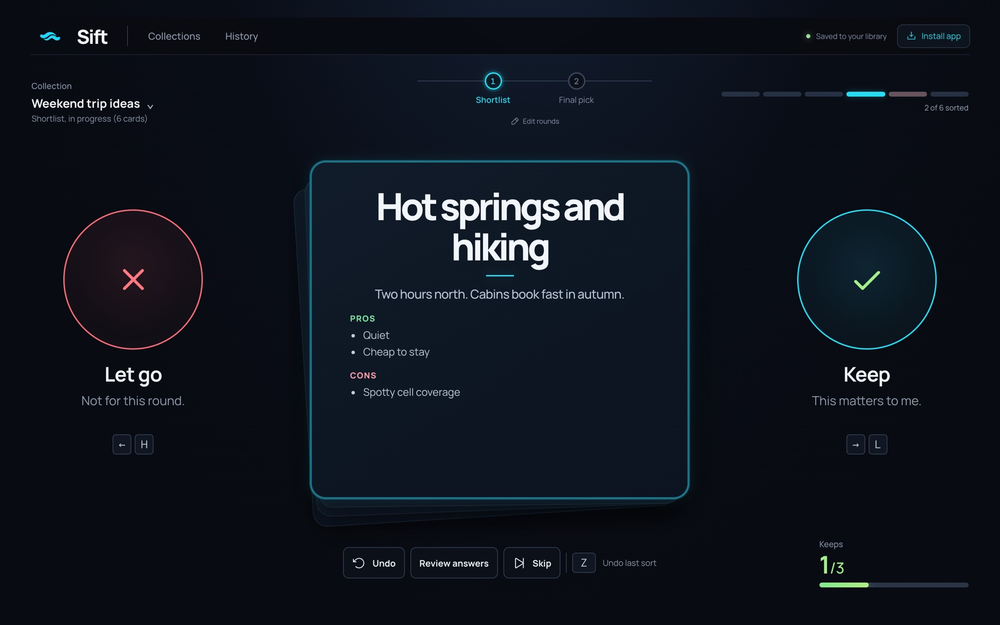
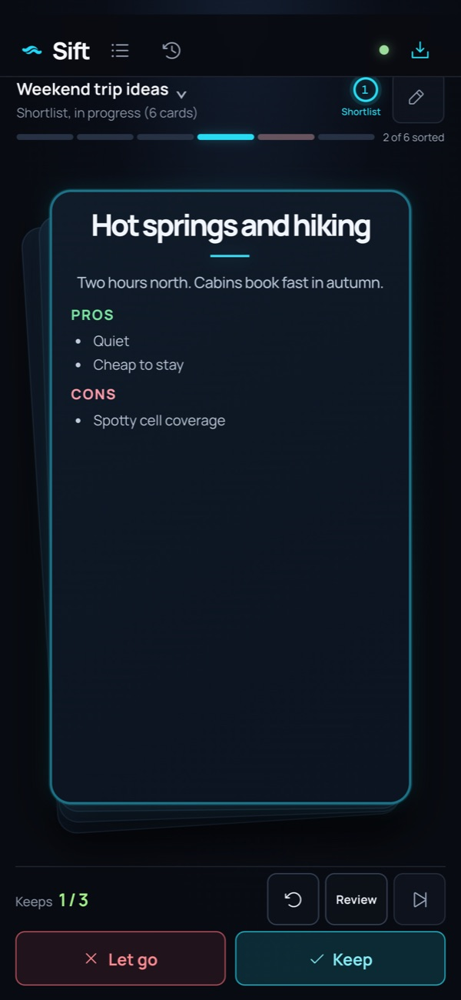
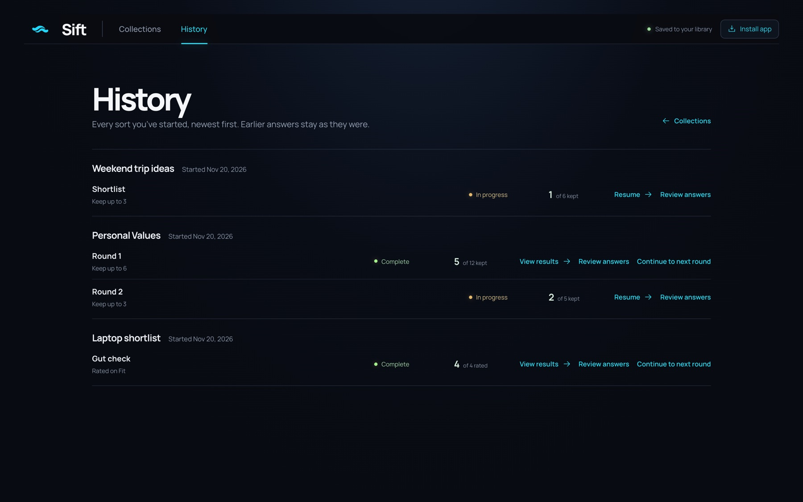
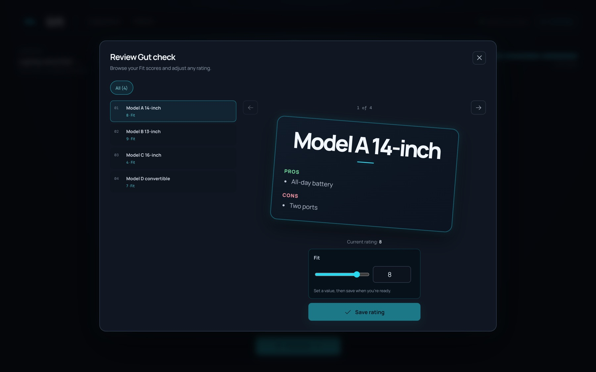
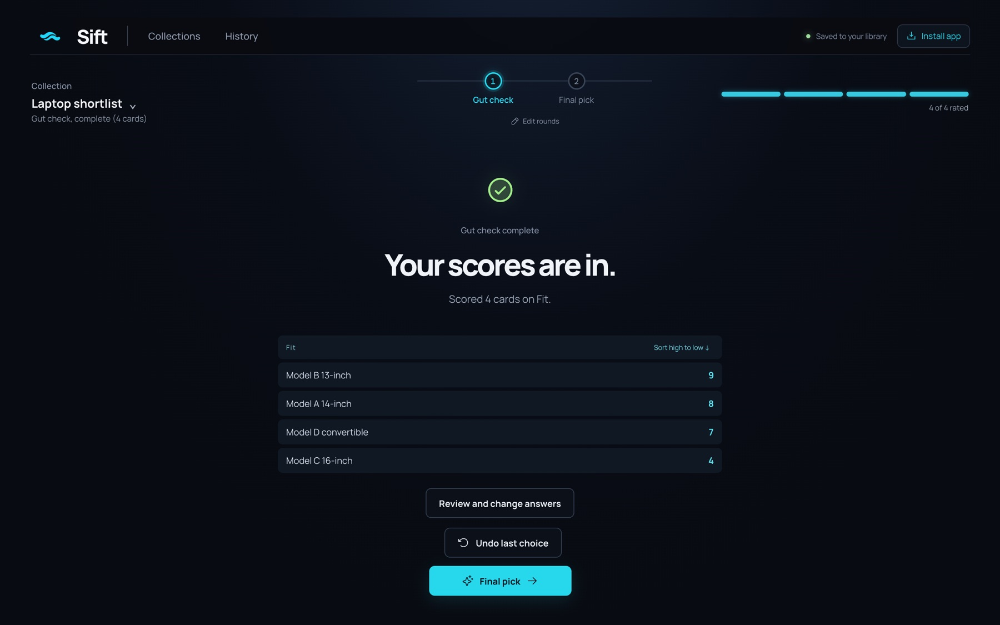
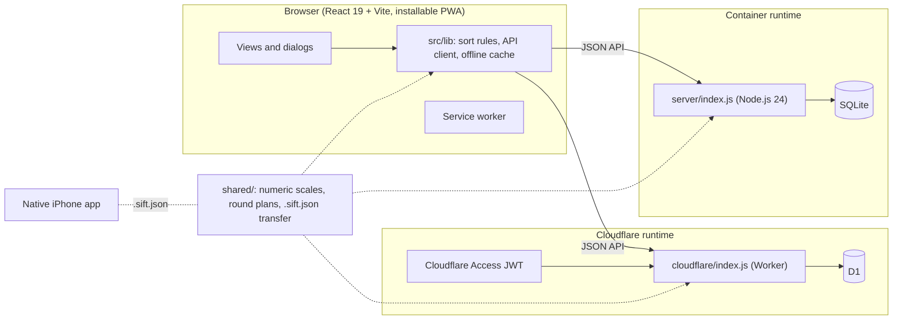

# Sift

Sift helps you narrow a long list down to what matters by keeping or letting go of one card at a time, across as many rounds as you need. It's an installable React web app with one JSON API that runs on either Node.js with SQLite or Cloudflare Workers with D1, and it shares a file format with a native iPhone app.



<p>
  
  
</p>

Every screenshot uses fictional sample data.

## What it does

- **Rounds.** Plan as many rounds as you like. Each keep-or-let-go round has a keep limit, which you can preset or choose when the round starts, and only the keeps carry into the next round.
- **Rating rounds.** Instead of keep or let go, score every card on a custom scale, such as Fit from 0 to 10 or Price in USD, then sort the results high to low. Every rated card carries into the next round.
- **Card context.** Cards can carry a description, pros and cons, and numeric values like cost or weight.
- **Review and revise.** Browse earlier answers with filters and Previous/Next. Changing an answer after later rounds exist creates a revised path, and the original results stay intact.
- **Fast input everywhere.** Swipe on touch screens, use H/L or the arrow keys on a keyboard, Z to undo, and Skip to send a card to the back of the queue.
- **Works offline, read-only.** Sift is an installable PWA. Offline, it shows your cached library and blocks writes until it reconnects and refreshes.
- **Portable.** Export one collection or the whole library as a versioned `.sift.json` file that the iPhone app reads and writes too.

| Review and change answers | Ratings, highest first |
| --- | --- |
|  |  |

## Architecture



| Path | What lives there |
| --- | --- |
| `src/views/` | Sort, Collections, History and API keys screens |
| `src/dialogs/` | Collection editor, round planning, review |
| `src/components/` | Swipe card, card face, numeric controls, modal |
| `src/lib/` | API client and offline cache, sort session rules, keyboard and gesture logic |
| `shared/` | Rules shared by the browser and both servers |
| `server/` | Node.js + SQLite runtime |
| `cloudflare/` | Worker + D1 runtime, Access and API key security, migrations |
| `tests/` | `node:test` suites for all of the above |

### The three biggest design calls

1. **History is append-only, and edits fork instead of overwrite.** Decisions are a log. Undo marks a row instead of deleting it, and revising an earlier round forks a new path that keeps the old one. Sort writes carry the revision they were based on, and collection edits carry their last-saved time, so a second tab or device gets `409 revision_conflict` instead of silently overwriting newer work. The cost is more storage and more complex reads; the payoff is that no answer is ever lost.
2. **One API, two runtimes.** The same JSON API runs as a Node.js server on built-in SQLite (`node:sqlite`, no external database) and as a Cloudflare Worker on D1, and the tests run both, the Worker inside real `workerd` through Miniflare. Anyone can self-host the container with one command, and the author's copy runs at the edge for free. The trade-off is that the two request handlers are duplicated today; merging them into one core with two storage adapters is the top item on the roadmap.
3. **Authentication is verified in the Worker and fails closed.** The app hostname sits behind Cloudflare Access, and the Worker itself verifies the signed Access JWT (issuer, audience, expiry, owner) on every app and asset request instead of trusting identity headers. Only two public pages, privacy and support, skip it. A separate API hostname accepts revocable bearer keys stored only as SHA-256 digests. Browser writes need a same-origin `Origin` header. If the hostnames or Access settings are missing, the Worker refuses requests instead of guessing.

The `.sift.json` format is versioned so that older apps reject numeric data instead of silently dropping it, and conflicting imports become separate versions instead of overwriting anything. See [the format spec](docs/transfer-format.md).

## How it runs

- **Hosting.** The author's private copy runs on Cloudflare Workers and D1 on the Free plan, behind Cloudflare Access with a single allowed owner. A Docker Compose setup runs the Node.js + SQLite version behind any access proxy. See [self-hosting](docs/self-hosting.md).
- **Deploy path.** Releases are manual and gated on the owner's approval. Each one builds and tests, does a Wrangler dry run against a production config kept outside the repo, exports a D1 backup, applies only additive migrations, deploys, and then runs acceptance checks. Anonymous requests must redirect to Access, API calls without a key must get `401`, the owner must load the new bundle, and D1 table fingerprints must match their pre-release values. Release receipts are in [`docs/reviews/`](docs/reviews/) and [the deployment log](docs/cloudflare-deployment.md). Rollback switches back to the previous Worker version and keeps all data.
- **CI/CD.** GitHub Actions ([`.github/workflows/ci.yml`](.github/workflows/ci.yml)) installs dependencies, builds and runs the full test suite on every push to `main` and every pull request. Deployment is deliberately not automated.
- **Secrets.** The repo contains none. Hostnames, the D1 database ID and Access settings are placeholders in [`wrangler.jsonc`](wrangler.jsonc). The real values live in a git-ignored, owner-only (mode 600) production config on the operator's machine, and Wrangler authenticates with the operator's own Cloudflare sign-in. Access tokens are checked against Cloudflare's public signing keys, so there is no shared secret to leak. API keys are shown once and stored only as hashes.

## How I know it's healthy

- **Monitoring.** Health is checked at every release by the acceptance checks above. Between releases, Cloudflare's built-in Workers metrics show requests, errors and CPU time. There is no automated uptime check.
- **Logs.** Errors reach clients as generic JSON codes without internal details. `wrangler tail` streams live Worker logs when something needs investigating; logs are not stored.
- **Alerts.** None are configured. For a single-user app this is an accepted gap, and it's the first thing to add before anyone else relies on it.
- **Backups.** Every migration is preceded by a full D1 export kept on the operator's machine, and table fingerprints are compared before and after. D1's Time Travel also allows point-in-time restores within the plan's retention window. For the container, back up the `sift-data` volume. Older backups are never restored over newer data automatically.
- **Something that broke.** During one release, the deploy wrapper script reported failure after `wrangler deploy` had actually succeeded. Its summary step used a variable named `status`, which is read-only in zsh. The release checklist doesn't trust exit codes alone: the Wrangler log and Cloudflare's own readback showed the new version serving 100% of traffic. So the fix was to record the false failure and not redeploy. A blind retry would have shipped the same code twice and muddied the rollback pointer. The lesson that stuck: verify against the provider's state, not the script's summary.

## How it was built

> **Draft:** this section is pending the author's review.

Sift was built through agentic coding. OpenAI Codex wrote most of the original implementation: the React front end, both API runtimes, the security layer, the transfer format and most of the tests. Claude Code later restructured the front end, refreshed the design, rewrote the documentation and prepared this public release. A human set the direction, made the product calls, recorded durable UX rules in [`AGENTS.md`](AGENTS.md) and approved every release.

Material changes went through adversarial review by models that didn't write them, including GPT models through Codex, open-weight models such as DeepSeek and GLM through Ollama Cloud, and Claude subagents. The lead agent checked each finding against the source and either adopted it or rejected it with a reason. Those review receipts are in [`docs/reviews/`](docs/reviews/). Each change also had to pass the `node:test` suite, which covers the sort rules, both runtimes, the security boundaries and the transfer format, plus browser checks at phone and desktop widths.

## Run it yourself

You need Node.js 24 or newer.

```sh
npm ci
npm run dev:server   # API on http://127.0.0.1:3000, data in .local/sift.sqlite
npm run dev          # app on http://localhost:4173, proxies /api to the server
```

Run the two commands in separate terminals. A new database starts with a fictional example collection, Personal Values. Set `SIFT_SEED_DEMO=0` for an empty library, or `SIFT_DB_PATH` to keep data somewhere else.

To try the Cloudflare runtime locally, with synthetic Access credentials and isolated D1 storage, run `npm run build` and then `npm run dev:worker:preview`.

To run the tests:

```sh
npm run build   # the suite checks the generated build output, so build first
npm test
```

More documentation:

- [Using Sift](docs/user-guide.md): rounds, review, ratings and transfers in detail
- [HTTP API](docs/api.md)
- [Self-hosting](docs/self-hosting.md): the container behind an access proxy, or Cloudflare Workers and D1
- [`.sift.json` transfer format](docs/transfer-format.md) and the [ratings contract](docs/ratings-contract.md)
- [Documentation index](docs/README.md)

## License and status

[MIT](LICENSE). Bundled dependencies and fonts keep their own licenses; see the [third-party notices](public/third-party-notices.txt).

Sift is a personal project in active use by its author. The hosted copy is private, so there is no public demo; use the local setup above. The native iPhone app lives in a separate repository and is in private TestFlight testing. Known gaps are no alerting or uptime monitoring, and the API is duplicated across the two runtimes.
